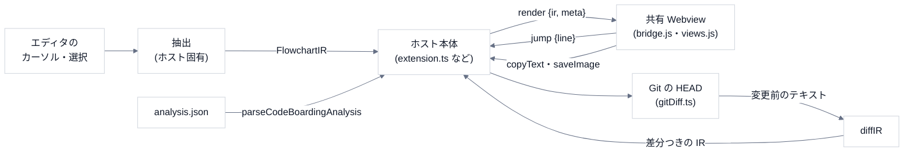

# 1. 全体像

## 部品と、データの流れ

- **抽出**: カーソルのある関数を、**FlowchartIR** にする(ホストごとに別の実装)。
- **ホスト本体**: IR を Webview へ渡し、Webview からの要求(行へ飛ぶ・コピー・保存)を受ける。
- **共有 Webview**: IR からビューを作り、Mermaid で描く。**3 ホストで同じファイル**。
- **差分**: HEAD のファイル全文から、同じ名前の関数を切り出して、いまの関数と比べる。
- **全体の階層**: CodeBoarding の出力を、中立なモデルに直して Webview へ渡す。

## 3 つのホストの状態

| ホスト | 抽出 | 差分・全体 | 状態 |
|---|---|---|---|
| VS Code | DocumentSymbol + 括弧の走査 / tree-sitter / 走査 | あり | **実機で検証済み**(結合テストあり) |
| Visual Studio | Roslyn `ControlFlowGraph` / SyntaxWalker | なし | `dotnet build` と C# のテストまで。**本体での起動は未確認** |
| Rider | Java PSI | なし | **ビルド未確認**。C# は未対応 |

## ビルドの前提(つまずきやすい)

| もの | どこから | 注意 |
|---|---|---|
| `core/webview-bundle/mermaid.min.js` | `npm run fetch-mermaid`(`node_modules/mermaid` からコピー) | **Git に入っていない**(`.gitignore`)。無いと Webview が描けない |
| `vscode-extension/wasm/`(tree-sitter) | `npm install` の `postinstall`(`fetch-wasm.js`) | Git に入っていない。オフラインで動くよう、CDN を使わない |
| `vscode-extension/webview-bundle/` | `npm run compile` が `core/webview-bundle/` から**複製** | **直接は編集しない**(毎回消して作り直す)。古いコピーが優先されるのを防ぐため |
| `dist/`(両方) | `tsc` | 文書の実行例も、これを使う |

## 設定値

| 名前 | 既定 | 意味 |
|---|---|---|
| `flowchart.autoRefresh` | false | 保存時に自動で図を作り直す(パネルが開いているときだけ。500 ms のデバウンス) |
| `flowchart.followCursor` | false | カーソルのある関数が変わったら、図を切り替える(400 ms のデバウンス) |

## やらないこと(範囲の外)

- **実行時の情報**(実際にどの分岐を通ったか)。カバレッジとの連携(X5)は、意図的に未実装。
- **意味の解析**(型・呼び出し先)。
- Python のように**インデントでブロックを表す言語**(図を作らず、帯で「未対応」と知らせる)。
